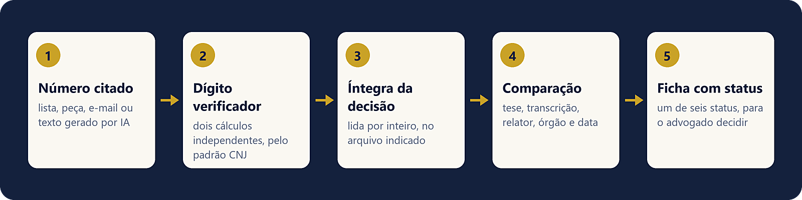

# Valida Julgado

**Confere citações de julgados brasileiros antes de o advogado usá-las.** O plugin orienta
a conferência do dígito verificador do número CNJ e a leitura da íntegra, compara a decisão
com o que a citação afirma e registra o resultado em uma ficha.

> **Revisão obrigatória.** O plugin não dá orientação jurídica nem decide o que citar. Um
> profissional qualificado precisa revisar o resultado, e quem receber a orientação precisa
> ser informado de que houve uso de IA.



## Exemplo de ficha

Dados fictícios, da pasta `examples/`:

```text
## 0000001-93.1900.8.26.0000 — 1ª Câmara de Direito Público, Rel. Fulano de Tal, j. 10/03/2020
- Status: DIVERGENTE
- DV: correto (prova=1, DV esperado=93)
- Origem da íntegra: arquivo sem origem oficial — lida em 07/11/2026
- Resultado e votação: recurso desprovido, por unanimidade
- Citação x decisão: diverge em: a lista atribui pagamento retroativo; o voto o afasta
- Ementa x voto: ementa mais ampla que o voto
- Sinais e ocorrências: marcador "[1]" sem referência correspondente

## 0000001-00.1900.8.26.0000 — 2ª Câmara de Direito Público, Rel. Beltrano de Tal, j. 11/03/2020
- Status: NÚMERO INVÁLIDO
- DV: inválido (esperado 93)
```

## Uso jurídico: revisão obrigatória

Trabalho jurídico é caso de alto risco na
[Política de Uso da Anthropic](https://www.anthropic.com/legal/aup): um profissional
qualificado precisa revisar o resultado e poder alterá-lo, e quem receber a orientação
precisa ser informado claramente de que houve uso de IA.

## O que o plugin executa, envia ou busca

- **Executa:** nada por conta própria. O plugin contém só instruções em texto para o
  Claude. Não tem script, conector, hook nem endereço remoto, e não coleta dados. Para a
  conta do DV, o Claude pode usar a ferramenta de cálculo que a sessão já tenha, inclusive
  execução de código da própria sessão, sob as permissões do usuário.
- **Grava** a ficha `verificacao-julgados.md` na pasta de trabalho, por meio do Claude.
- **Envia ou busca:** nada por conta própria. Se a sessão já tiver pesquisa de
  jurisprudência ou acesso à web, a skill pergunta antes de usar.

Os documentos que o usuário indica são lidos pelo Claude, conforme a conta e as
configurações de dados do próprio usuário.

## Exemplos de uso

Os números abaixo são fictícios.

1. **Conferir números**

   > Confira estes números: 0000001-93.1900.8.26.0000 e 0000001-00.1900.8.26.0000.

   O primeiro tem DV correto, o que não prova que o processo exista. O segundo recebe
   `NÚMERO INVÁLIDO`, com DV esperado 93.

2. **Conferir uma citação com a íntegra**

   > Anexei o acórdão em PDF, baixado do portal do tribunal. Confira se ele decide a tese
   > que transcrevi nesta minuta.

   O Claude lê a íntegra, compara tese, transcrição e dados, e grava a ficha com o status.

3. **Triar lista recebida de terceiro ou de IA**

   > Recebi esta lista de julgados de uma ferramenta de IA. Valide cada um antes de eu
   > usar.

   O Claude confere os números, aponta sinais de citação gerada por IA e pede as íntegras
   que faltam.

## Dados de teste

O plugin não tem conta, login nem serviço. Para testar, use os arquivos fictícios da pasta
`examples/` e peça:

> Valide a lista `lista-ficticia.md` usando os acórdãos `acordao-0000001.md` e
> `acordao-0000003.md`.

Resultado esperado:

| Item | Status | Motivo |
|---|---|---|
| 1 | `DIVERGENTE` | O voto afasta o pagamento retroativo que a lista atribui à decisão |
| 2 | `NÚMERO INVÁLIDO` | DV esperado 93 |
| 3 | `NÃO LOCALIZADO` | Sem íntegra; a data de julgamento cai em um sábado |
| 4 | `NÃO LOCALIZADO` | Sem íntegra; o DV não se aplica a REsp |
| 5 | `ÍNTEGRA SEM ORIGEM CONFERIDA` | A citação confere, mas o arquivo não tem origem oficial |

## Status da ficha

| Status | Significado |
|---|---|
| `CONFIRMADO NA ÍNTEGRA` | Íntegra lida, de origem oficial identificada, e a citação confere |
| `ÍNTEGRA SEM ORIGEM CONFERIDA` | Íntegra lida e citação confere, mas sem origem oficial identificada |
| `DIVERGENTE` | Íntegra lida, mas tese, transcrição ou dados não conferem |
| `SÓ EMENTA` | Só a ementa foi lida |
| `NÃO LOCALIZADO` | Decisão não encontrada; conferência manual pendente |
| `NÚMERO INVÁLIDO` | DV ou formato não obedece ao padrão CNJ |

## Solução de problemas

- **A skill não foi acionada:** confira se o plugin está ativo e peça de forma direta,
  como "valide estes julgados" ou "use a skill valida-julgado".
- **"DV não conferido":** os dois cálculos não bateram. Peça para refazer a conta, ou
  confira o número no portal do tribunal. Esse resultado não significa que o número seja
  inválido.
- **`NÃO LOCALIZADO`:** falta a decisão. Baixe a íntegra no portal do tribunal e indique o
  arquivo.
- **`ÍNTEGRA SEM ORIGEM CONFERIDA`:** informe de onde veio o arquivo, ou confira a decisão
  no portal do tribunal.
- **PDF não lido:** se o arquivo for escaneado ou estiver protegido, forneça uma cópia com
  texto legível.
- **A ficha não apareceu na pasta:** sem pasta de trabalho, como na conversa pelo
  navegador ou pelo celular, a ficha vem na própria resposta.

## Limites

- DV correto não prova que o processo exista. A regra está na
  [Resolução CNJ nº 65/2008](https://atos.cnj.jus.br/atos/detalhar/119), art. 1º, § 2º, e
  Anexo VIII.
- A conta do DV é feita pelo Claude, sem programa próprio, e pode errar. Ele faz dois
  cálculos independentes e, se não baterem, registra "DV não conferido".
- O plugin não verifica reforma posterior, trânsito em julgado nem vigência do
  entendimento.
- O plugin não atesta a autenticidade de arquivo sem origem oficial.
- O plugin não faz triagem de malware nem de texto oculto nos arquivos.

## Privacidade

A ficha pode conter nomes de partes e magistrados e fica só na pasta de trabalho do
usuário. Os autores não recebem o conteúdo dos documentos nem da ficha. Veja a
[política de privacidade](PRIVACY.md).

## Autoria

Marcos Eduardo Miranda e Eduardo Miranda Sociedade de Advogados.

## Suporte e segurança

Dúvidas, problemas e relatos de vulnerabilidade de segurança:
contato@mirandaadv.com.br. Para relatos de segurança, veja também a
[política de segurança](SECURITY.md). As mudanças de cada versão estão no
[histórico de versões](CHANGELOG.md).

## Licença

MIT. Veja o arquivo `LICENSE`.

## English summary

Valida Julgado helps lawyers check citations of Brazilian court decisions. It guides the
check of the CNJ case-number check digit using the official method, a full reading of the
decision and a comparison with the citation, and it records a status sheet. The plugin
contains only text instructions: no script, connector, hook or remote endpoint. A
qualified professional must review the output. Sample data is in `examples/`. Security
reports: see `SECURITY.md`.
